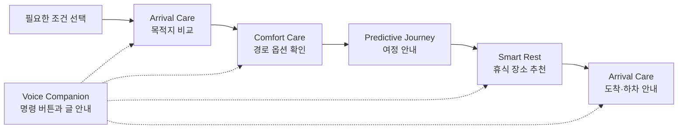

# 모두고 · MODUGO

### 가장 빠른 길보다, 나에게 맞는 길.

**모두고는 목적지의 접근성, 이동 중 휴식, 편안한 경로 선택을 연결하는 Pleos Connect 기반 이동 케어 앱입니다.**

가까운 목적지라도 출입구를 이용하기 어렵거나 하차할 곳이 마땅하지 않으면 적합한 선택이 아닐 수 있습니다. 모두고는 사용자가 직접 선택한 편의 조건을 바탕으로 목적지를 비교하고, 출발부터 휴식과 하차까지 하나의 여정으로 안내합니다.

## 대표 시연: 병원 A와 B 중 어디로 갈까요?

| 가상 후보 | 거리 · 예상 시간 | 무단차 출입구 | 필수 조건을 켰을 때 |
| --- | --- | --- | --- |
| 병원 A | 5 km · 12분 | 조건 미충족 | 선택 제외 |
| **병원 B** | **6 km · 15분** | **확인됨으로 설정** | **우선 추천** |
| 병원 C | 4 km · 10분 | 정보 미확인 | 추천 보류 · 확인 후 선택 검토 |

병원 B를 선택한 다음 편안한 경로를 적용하고, 이동 중 추천 휴식 장소를 경유지로 선택할 수 있습니다. 목적지에 가까워지면 선택한 병원의 주차·하차 위치와 출입구 정보를 안내합니다.

> 병원 이름, 시설 상태, 거리와 시간은 모두 시연용 가상 데이터입니다. 실제 병원 검색이나 시설 접근성 검증 결과가 아닙니다.

## 다섯 가지 이동 케어

| 기능 | 제공하는 경험 |
| --- | --- |
| **Smart Rest** | 이동 시간과 휴식 간격을 바탕으로 안내하고, 출입구·편의시설·추가 이동 부담을 고려해 휴식 장소 추천 |
| **Predictive Journey** | 선택한 목적지, 남은 거리·시간, 경로 옵션과 휴식 경유지를 함께 표시 |
| **Voice Companion** | 목적지 비교·휴식·경로 옵션 등 6개 명령 버튼과 텍스트 응답 제공 |
| **Arrival Care** | 목적지 선택 단계의 접근성 비교부터 도착 후 주차·출입구·하차 준비까지 연결 |
| **Comfort Care** | 편안한 경로 선호, 차량 환경 정보, 이동 시간에 따른 Motion Care 안내 |

사용자를 고정된 유형으로 분류하지 않습니다. 무단차 출입구, 휴식 편의시설, 편안한 경로, 음성 중심 안내, Motion Care 등 필요한 조건을 직접 조합합니다.

## 추천과 조작 원칙

- **필수 조건 우선:** 무단차 출입구가 필요하면 조건을 충족하는 후보부터 비교합니다. 이후 거리·시간과 편의 조건을 고려합니다.
- **정보 상태 구분:** 확인됨, 조건 미충족, 미확인을 구분합니다. 정보가 없다는 이유로 이용 가능하거나 불가능하다고 단정하지 않습니다.
- **추천 이유 표시:** 필요한 시설, 경로 인근 여부, 추가 이동 시간 등 비교 근거를 보여줍니다.
- **사용자 확인:** 목적지·경유지·경로 옵션은 확인 후 적용합니다. 선호 설정만으로 경로를 바꾸지 않습니다.
- **이동 상태에 맞는 화면:** 정차 중에는 비교와 설정을, 주행 중에는 핵심 여정과 간결한 안내를 제공합니다.

## 구현 범위

| 구분 | 현재 구현 |
| --- | --- |
| `mockDebug` | 통합 추천, 8개 시연 상황, 사용자 확인, 설정 저장, 주요 화면 Preview |
| `realDebug` | NaviHelper 목적지·경로 정보 수신, Vehicle State 조회, 플랫폼 UX 제한 반영 코드 |
| 검증 | 두 변형 APK 빌드 성공, 각 변형에서 공통 단위 테스트 43개 통과 |
| 후속 검증 | 지원 기기에서 SDK 수신·주행 제한·화면 조작 확인 |

목적지·휴식 장소의 시설 정보와 경로 변경은 **Mock**으로 동작합니다. 실제 경로 변경, 외부 시설 검색, TTS/STT, 차량 장치 제어는 제공하지 않습니다. SDK 조회 코드는 컴파일 검증을 완료했으며, 실제 서비스 수신은 지원 환경에서 통합 검증이 필요합니다.

## 프로젝트 살펴보기

- [시연 가이드](android/docs/INTEGRATED_DEMO.md): 병원 비교부터 도착까지의 조작 순서
- [Android 빌드·실행](android/README.md): 프로젝트 열기, Build Variant, Compose Preview, 검증 명령
- [앱 구조와 추천 로직](android/docs/ARCHITECTURE.md): 공유 상태와 기능 간 연결
- [SDK 연동 범위](android/docs/SDK_INTEGRATION.md): 조회 항목, 권한과 후속 연동 경계
- [검증 결과](android/docs/VALIDATION.md): 테스트 항목과 검증 범위

**기술 구성:** Kotlin · Jetpack Compose · ViewModel · StateFlow · JUnit · Pleos NaviHelper / Vehicle SDK

Android Studio에서 저장소의 **`android` 폴더**를 열고 `mockDebug`를 선택하면 시연 환경을 준비할 수 있습니다.
